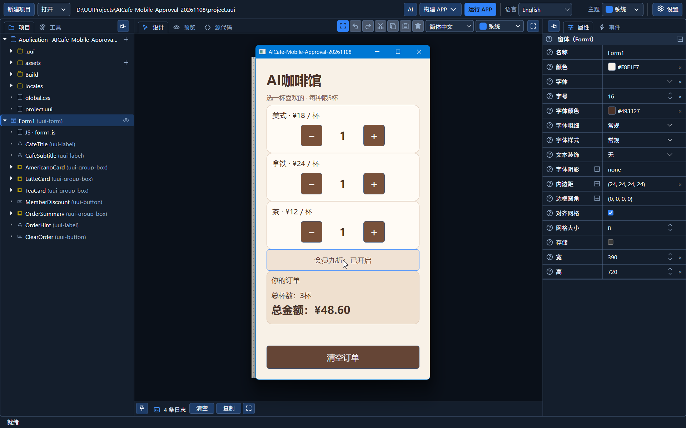

# UUI Studio

[简体中文](README.md) · English

[Downloads and demo](docs/en/downloads.md) · [Getting started and testing](docs/en/testing.md) · [English stories](stories/en/README.md)

<picture>
  <source media="(prefers-color-scheme: dark)" srcset="assets/brand/uui-studio-horizontal-dark.svg">
  <source media="(prefers-color-scheme: light)" srcset="assets/brand/uui-studio-horizontal-light.svg">
  
</picture>

UUI Studio, short for Unified User Interface Studio, is an application development tool with visual design and AI collaboration. People edit through the designer, while AI operates through a protocol, both working on the same editable project. After generation, you can continue adjusting the interface, inspecting business logic, and adding requirements.

This introduction covers the **Windows preview test version 0.1.0, build 2026-11-10-locale-approval.1 (localization and approval revision 1)**. Developers are welcome to try it, provide feedback, and discuss joint technical evaluation and product collaboration.

## From requirements to a maintainable application

Describe your goal in everyday language, optionally with screenshots as references. AI first explains its understanding, implementation steps, and verification plan. Only after approval in Studio does it create components, write events, save, build, and check. Problems within the approved scope can be fixed and checked again; expanding the scope requires renewed approval.

People and AI can take turns working on the same components, properties, event bindings, and associated JavaScript modules. Existing components retain their identity when moved, and properties can be reset to default or inherited behavior. The platform provides common layout, theme, language, and data interfaces. Professional developers can still inspect and write business logic.

## Demo and downloads

**The Windows preview test version is available to download.** [View this release](https://github.com/felixdds/uui-studio/releases/tag/v0.1.0-preview.20261110-locale-approval.1).

[Installer (recommended)](https://github.com/felixdds/uui-studio/releases/download/v0.1.0-preview.20261110-locale-approval.1/UUI-Studio-0.1.0-Windows-Rust-Setup.exe) · [Portable ZIP (optional)](https://github.com/felixdds/uui-studio/releases/download/v0.1.0-preview.20261110-locale-approval.1/UUI-Studio-0.1.0-Windows-Rust.zip) · [Demo video in Chinese](https://github.com/felixdds/uui-studio/releases/download/v0.1.0-preview.20261110-locale-approval.1/UUI-Studio-AI-Cafe-Demo-zh-CN.mp4) · [Checksums](https://github.com/felixdds/uui-studio/releases/download/v0.1.0-preview.20261110-locale-approval.1/SHA256SUMS.txt)

[Download and demo guide](docs/en/downloads.md) · [Release notes](RELEASE_NOTES.en.md) · [Getting started and test feedback](docs/en/testing.md)

The coffee ordering recording lasts approximately 3 minutes 35 seconds. It starts from a blank project, generates an ordering interface, adds a 10% member discount, includes a human review and color correction, and checks checkout behavior in an actual Windows application. The recording is unchanged and does not newly demonstrate this batch's language groups or staged approval. Narration and subtitles are in Chinese. Accelerated waiting and execution segments are marked. The phone-proportioned window runs on Windows; it is not evidence that this release has passed physical mobile-device acceptance testing.

| File | Purpose | Size |
| --- | --- | --- |
| UUI-Studio-0.1.0-Windows-Rust-Setup.exe | Recommended standalone installer; no separate ZIP needed | 54.64 MiB |
| UUI-Studio-0.1.0-Windows-Rust.zip | Optional portable package; extract the entire directory before running | 84.31 MiB |

Both packages use a Rust host, with HTML/CSS/JavaScript for the interface and business logic. Running Studio and building user applications do not require Python or an installed Rust compiler. The packages include Chinese and English offline help and ten editable examples. AI use requires configuring your own service and API key; fees and available models depend on the provider.

## Updates in this release

- The language editor groups entries as removed from source, needs updating, and updated, with filtered counts. Completed target translations remain editable, and cleanup persists after restarting.
- The approval control is a SplitButton: the main button approves, and the menu selects task approval (default) or approval by implementation stage. Policies cannot change while a plan awaits approval or a task is running.
- Native approval records associate plans, stages, scope, and versions. Stage pauses, scope enforcement, cancellation, and log checks remain host-controlled. A plus button before the input attaches images, and conversation titles support two lines.
- Chinese and English built-in help are synchronized. The new portable package and an isolated installation of the same payload were checked for startup, editing and saving, application builds and reopening, plus localization and approval behavior. Older releases remain available; see the [release notes](RELEASE_NOTES.en.md).

## Current validation scope

Approval-specific checks for this batch use a scripted test provider with real local builds, applications, and native permission checks; they do not constitute new online model acceptance testing. Installation checks use the same template and payload with a separate test installation identity, not every clean-machine environment.

There is evidence from actual Windows Studio operation and standalone application builds and runs. Evidence of the online AI workflow comes from OpenAI and small, single-Form applications. AI has access to the complete component contracts, but this does not mean all component behavior has passed online acceptance testing. Other model services, AI orchestration across Forms, and online databases require separate validation.

Android output currently uses Rust ARM64. The minimum OS target is Android 10/API 29; WebView 120 is a candidate minimum still awaiting validation on minimum-spec devices. The current Rust versions for macOS, Linux, and iOS have not completed comprehensive native acceptance testing. iOS/iPadOS 17 is the target range. General bridging to other programming languages remains a future direction.

## The stories behind UUI Studio

UUI Studio was conceived by a dentist who leads its architectural design. Requirements, rules, and interaction judgments are handled by a person; Codex generates the implementation code. The project progressed in the gaps between everyday work: let AI handle what it can, contribute our respective strengths, and neither dismiss others nor discount our own contribution.

[Where the cross-platform idea began](stories/en/01-origin.md) · [Five months of development in the gaps](stories/en/02-between-patients.md) · [The little cross beside a property](stories/en/03-inline-properties.md)

[All eight stories in English](stories/en/README.md) · [中文故事目录](stories/README.md)

[A Software Developer's Perspective](docs/en/review.md) · [中文评述](docs/review.md)

## Joint evaluation and collaboration

We welcome conversations with teams working on development tools, developer productivity, and applications. The architecture designer and professional engineers can choose a small business scenario together, evaluate maintainability, incremental AI changes, builds, and diagnosis, then discuss product improvements, distribution, and promotion. You can express interest in technical discussions through [Issues](https://github.com/felixdds/uui-studio/issues). Do not include keys or private business information in public feedback.

This repository is for product presentation and test distribution. It does not contain Studio's complete Rust source code. Providing public material and test packages does not constitute an open-source license. Use and distribution are governed by the agreements supplied with the software and authorization from the rights holder.
