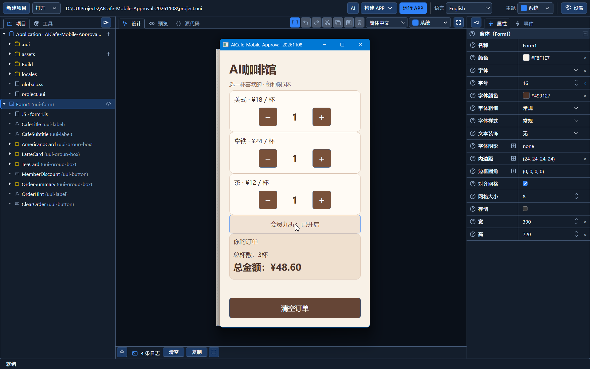
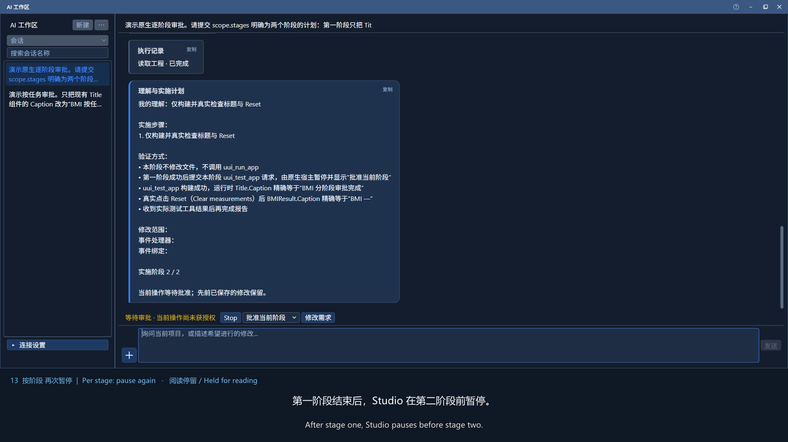

# UUI Studio

**帮助与简体中文修订：2026-11-11-help-locale.1。** 13 个操作窗口统一支持标题栏“？”和 F1，上下文帮助包含中英文，简单确认框不加。九项过时译文已更新；本批次干净安装的简体中文待更新为 0。旧软件和演示视频继续保留。

简体中文 · [English](README.en.md)

[中文故事](stories/README.md) · [English stories](stories/en/README.md) · [Developer commentary in English](docs/en/review.md)

<picture>
  <source media="(prefers-color-scheme: dark)" srcset="assets/brand/uui-studio-horizontal-dark.png">
  <source media="(prefers-color-scheme: light)" srcset="assets/brand/uui-studio-horizontal-light.png">
  
</picture>

统一用户界面工作室是一套支持可视化设计与 AI 协作的应用开发工具。人通过设计器编辑，AI 通过协议操作，共同维护同一份可编辑工程；生成后仍能继续调整界面、检查业务代码并追加需求。

本次介绍对应的 Windows 测试版本为 **0.1.0，2026-11-11-help-locale.1 构建批次（帮助与简体中文修订1）**。欢迎开发者试用、反馈，并探讨联合技术验证与产品合作。

## 从需求到可维护的应用

用日常语言描述目标，也可附加截图参考。AI 先说明理解、实施步骤和验证计划，经用户在 Studio 批准后才创建组件、编写事件、保存、构建和检查。范围内的问题可继续修复和复测，扩大修改范围需要重新批准。

人工与 AI 可以交替接手同一套组件、属性、事件绑定及关联 JavaScript 模块。已有组件移动时保留身份；属性可恢复默认或继承行为。平台提供统一布局、主题、语言及数据接口，专业开发者仍可检查和编写业务代码。

## 演示与下载

**Windows 预览测试版现已开放下载。** [查看本次发行](https://github.com/felixdds/uui-studio/releases/tag/v0.1.0-preview.20261111-help-locale.1)。

[下载安装包（推荐）](https://github.com/felixdds/uui-studio/releases/download/v0.1.0-preview.20261111-help-locale.1/UUI-Studio-0.1.0-Windows-Rust-Setup.exe) · [便携 ZIP（可选）](https://github.com/felixdds/uui-studio/releases/download/v0.1.0-preview.20261111-help-locale.1/UUI-Studio-0.1.0-Windows-Rust.zip) · [1080P 中英字幕演示](https://github.com/felixdds/uui-studio/releases/download/v0.1.0-preview.20261110-locale-approval.1/UUI-Studio-Localization-Approval-1080p-zh-en.mp4) · [校验文件](https://github.com/felixdds/uui-studio/releases/download/v0.1.0-preview.20261111-help-locale.1/SHA256SUMS.txt)

> **Windows 安装提示（SmartScreen）**：当前预览版尚未进行受信任的代码签名。下载或首次运行安装包／便携版程序时，Windows SmartScreen 可能显示“Windows 已保护你的电脑”或“未知发布者”。这类信誉提示本身不等于检测到病毒。请确认文件来自本项目官方 GitHub Releases，并可使用发布页的 SHA256 校验值核对文件是否一致。确认来源并决定信任后，可在系统提供该选项时点击“更多信息 → 仍要运行”。无需关闭 Windows Defender 或系统安全保护；如果出现具体的病毒检测提示，请停止运行并反馈。

[下载与演示](下载与演示.md) · [本次发行说明](RELEASE_NOTES.md) · [快速上手与测试反馈](测试指南.md)

新版演示约 2 分 34 秒，1920×1080、16:9、30 fps，中文旁白及中英字幕。展示翻译分组、按任务审批、真实阶段暂停与后续批准、构建检查及原生记录；加速与阅读停留均有标注。[观看说明及字幕](docs/demo-1080p.md)。[旧咖啡点餐演示](https://github.com/felixdds/uui-studio/releases/download/v0.1.0-preview.20261110-locale-approval.1/UUI-Studio-AI-Cafe-Demo-zh-CN.mp4)继续保留。

| 文件 | 用途 | 大小 |
| --- | --- | --- |
| UUI-Studio-0.1.0-Windows-Rust-Setup.exe | 推荐，独立安装，无需另下 ZIP | 55.69 MiB |
| UUI-Studio-0.1.0-Windows-Rust.zip | 可选，解压完整目录后运行 | 85.14 MiB |

安装包与便携版均使用 Rust 宿主，界面和业务脚本使用 HTML/CSS/JavaScript。运行 Studio 和构建用户 APP 不需要 Python 或安装 Rust 编译器。包含中英文离线帮助和十个可编辑示例。AI 需要自行配置服务与 API Key，调用费用及可用模型取决于服务方。

## 本次更新

- 语言编辑器按“已从源文移除、待更新、已更新”分组，显示筛选计数；完成的目标译文仍可编辑，清理结果在重启后保留。
- AI 批准入口使用 SplitButton：主按钮批准，下拉菜单选择“按任务（默认）”或“逐项（实施阶段）”；待批或执行中禁止切换策略。
- 原生审批记录关联计划、阶段、范围与版本；阶段暂停、越权拦截、取消及日志检查继续由宿主执行。图片入口为输入框前的“＋”，会话标题支持两行显示。
- 同步中英文内置帮助；新便携包及同载荷隔离安装已检查启动、编辑保存、用户 APP 构建与重开，并专项检查翻译及审批。旧版继续保留，详见[发行说明](RELEASE_NOTES.md)。

## 当前验证范围

安装包发布前的审批专项使用脚本化提供器与真实本地执行检查；本次新增视频另有真实 OpenAI 单 Form 的两种审批在线实录，仅覆盖标题修改与 Reset 检查。安装检查使用同一模板与同一载荷、独立测试安装身份，不覆盖所有干净机器环境。

Windows Studio 与独立 APP 已有真实运行及构建证据；AI 在线闭环证据来自 OpenAI 与单 Form 小应用。完整组件契约已公开给 AI，但不表示所有组件业务均完成在线验收。其他模型服务、AI 跨 Form 编排及在线数据库需要分别验证。

Android 当前为 Rust ARM64，最低系统目标为 Android10/API29，WebView120为待最低设备验收的候选下限。macOS、Linux 和 iOS 的当前 Rust 版本尚未完成全面原生验收；iOS/iPadOS17是目标范围。通用其他编程语言桥接仍为后续方向。

## UUI Studio 的故事

UUI Studio 由一名牙医提出构想并主导架构设计，需求、规则与交互判断由人负责，实现代码由 Codex 生成。项目在日常工作间隙逐步推进：AI 能干的事情，就尽量交给 AI，各取所长，不否定别人，也不否定自己。

[从一个跨平台构想开始](stories/01-origin.md) · [五个月的见缝插针式开发](stories/02-between-patients.md) · [一个属性旁边的小叉](stories/03-inline-properties.md)

[中文故事目录](stories/README.md) · [English stories](stories/en/README.md)

[软件开发者视角的评述](docs/review.md) · [Developer commentary in English](docs/en/review.md)

## 联合验证与合作

希望与开发工具、研发效能及应用开发团队交流，由架构设计者与专业工程师共同选择一个小型业务场景，验证工程可维护性、AI 增量修改、构建与问题定位，再讨论产品完善、发行及推广合作。欢迎通过[Issues](https://github.com/felixdds/uui-studio/issues) 提出技术交流意向，请勿在公开反馈中提交密钥或业务私密资料。

本仓库用于产品展示与测试分发，未附 Studio 完整 Rust 源码。公开资料和测试包的提供不构成开源许可；使用与分发范围以软件随附协议及权利方授权为准。
